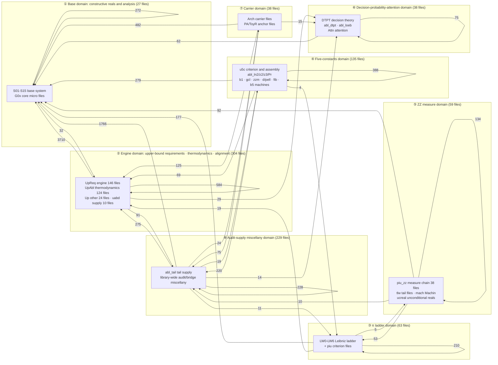
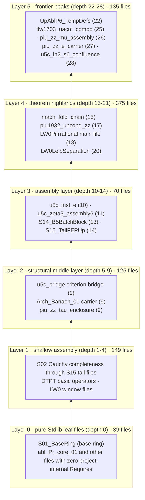
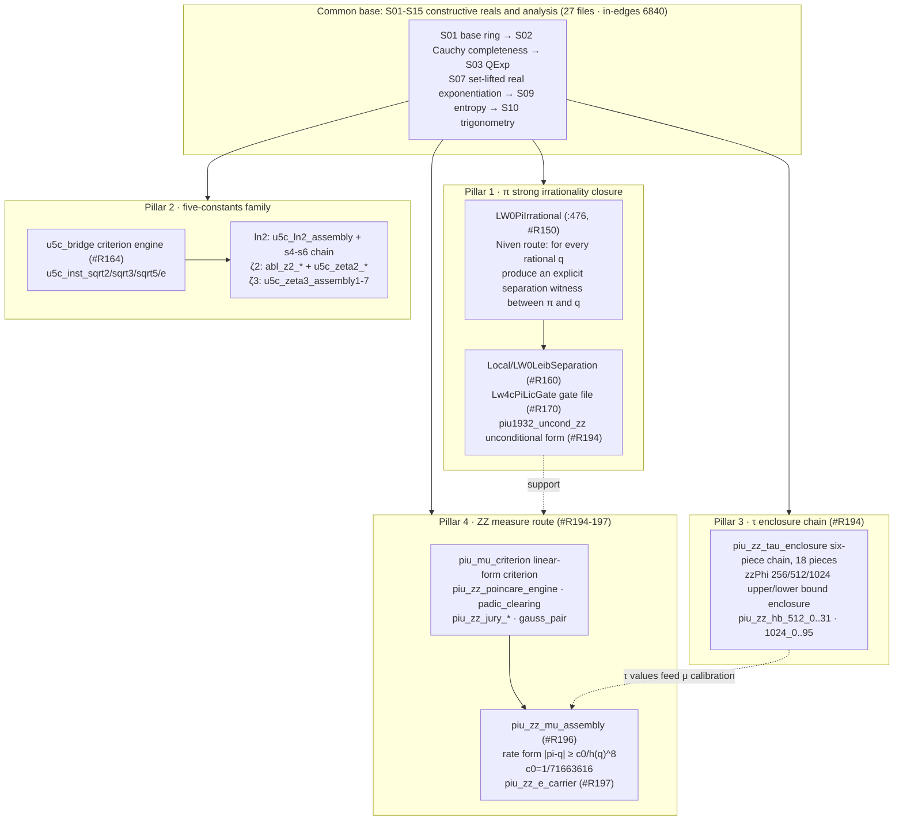
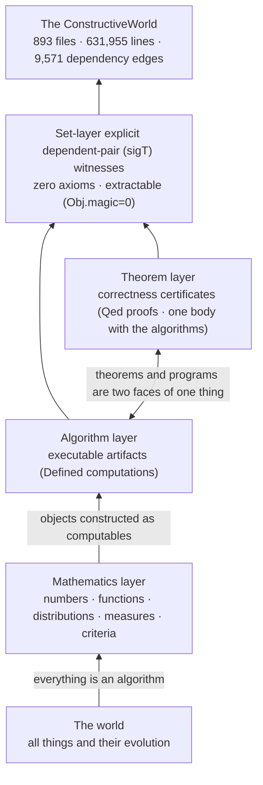

# ConstructiveWorld Structure Record (ARCHITECTURE)

**Data baseline date: 2026-10-28** (all figures are values measured on that day against the `ConstructiveWorld_Live/` working tree; statistical conventions and recomputation command forms are in Appendix A/B. This document was generated from a read-only field survey and modifies no source file, no registration surface, and no build product.)

---

## 0. Philosophical layer: construct everything constructible

The purpose of this library can be stated in one sentence: **construct everything constructible**. It is not a proof repository built around a single theorem, but a systematic attempt to construct, layer by layer, all things in the world as computable objects. Its methodological commitment: constructive computation as the unifying substrate, every constructible object, once constructed, is an algorithm. Algorithms are universal and are not the property of computers or artificial intelligence alone: the evolution of all things follows algorithms, and algorithms underlie the world's deep structure and govern the operating laws of every thing. Transplanting this conviction into the foundations of mathematics yields the way this library is built:

> Every `.v` file is an attempt to construct a piece of the world (a number, a function, a distribution, a measure criterion) as a computable object in type theory. To exist does not mean "assume it exists"; it means **produce a witness**: the whole library states its existential conclusions with explicit dependent-pair (`sigT`) witnesses at the `Set` layer of Rocq/Coq and introduces no axioms (`Axioms: <none>` under the `coqchk -o` convention).

The library README puts it precisely: "**theorems and programs are two faces of the same thing**". The executable artifact (a `Defined` computation) and its correctness certificate (a `Qed` proof) coexist in one body; inside the library this is called the "rate-is-algorithm" paradigm. This is exactly the type-theoretic form taken by the claim that everything is an algorithm: when a mathematical object is given constructively, the theorem about it is at the same time the program that produces it. The whole library extracts to target-language code via `Separate Extraction`, and the `Obj.magic` count being zero is the mechanical check; that is, **nothing leaks from the propositional layer into the algorithmic layer**. The purity of the construction is mechanically auditable.

Starting from a rational-number base, the library constructs, layer by layer, the real numbers, analysis, probability, information theory, decision and reinforcement-learning alignment, trigonometric functions and π, irrationality criteria and irrationality measures: a construction tower "from arithmetic to the world" (Figure ⑤).

---

## 1. Library-wide overview (measured 2026-10-28)

| Metric | Value | Convention |
|---|---|---|
| Total `.v` source files | **893** | root 892 + `Local/` 1 |
| Total source lines | **631,955** | root 626,232 + `Local/` 5,723 |
| Registered files (registration order) | **844** | `order.txt` has 844 lines; the line order is the compile dependency order |
| Registration batch-number span | `#R0` → `#R197` (74 batch numbers, **non-contiguous**) | batch numbers are cumulative, not sequential |
| Unregistered source files | **49** (including the probe file `_twc_probe.v`) | `.v` files present in the tree but absent from `order.txt` |
| Total `Require` tokens | 17,612 | module tokens on the `Require`/`From … Require` lines of all `.v` files |
| Internal dependency tokens (pointing into the library) | 11,403 | tokens matching a `.v` file name in the tree |
| Stdlib dependency tokens | 6,209 | pointing at `QArith`/`Arith`/`Lia`/`List`, etc. |
| Deduplicated internal file-level dependency edges | **9,571** | directed edges "file → the library file it Requires", deduplicated |
| Extraction products | 177 `.ml`/`.mli` each in the root | the on-disk audit objects of the `Separate Extraction` surface |
| Directly depending on one of the two base files | 734 / 893 files | `Require S01_BaseRing` or `S02_CauchyComplete` |

**Two-tree layout**: `ConstructiveWorld_Live/` (the source tree, containing `order.txt` and `_CoqProject`, with the `-Q . ""` flat namespace) and `ConstructiveWorld_vo/` (the artifact tree, which additionally holds `.vo`/`.glob` and the like). At the root there are also `CLA/` (contributor licenses), `docs/` (where this document lives), `releases/` (220 historical single-file merged editions), `scripts/` (registration-order maintenance and CI sentinels), `attn/` (historical working notes), and `Makefile`/`build.sh` (build entry points).

---

## 2. Figure gallery

### Figure ① Full domain map (domain map)

Nodes are the **eight mathematical domains** aggregated from module families; edges are measured inter-domain dependency edges (deduplicated at file level, labeled with edge counts; only the 31 main flows of ≥50 are drawn). How to read it: **the base domain is the absolute sink that everything depends on** (6,840 in-edges, 71.5% of the library); the engine domain is the largest dependency source (4,414 out-edges).



Legend: node annotations list the main file families and their file counts inside each domain; edge labels are deduplicated file-level dependency edge counts (measured 2026-10-28; convention in Appendix A.3). A further 18 low-flow edges with <10 are not drawn (PI→ZZ, FIVE→PI etc. are drawn; the six return-edge and end flows S_base→MISC 2, S_base→DECISION 1, PI→DECISION 1, DECISION→ENGINE 1, DECISION→CARRIER 1, CARRIER→CARRIER 1, totaling 7 edges, are omitted; full table in §5.2).

### Figure ② Dependency layering topology (layered topology)

The layering criterion is **require-chain depth**: `depth(f)=0` if f Requires no library file, otherwise `depth(f)=1+max(depth(dependency))` (the longest chain; recomputation command in Appendix A.4). The library-wide maximum depth is **28** (`u5c_ln2_s6_confluence.v`).



Legend: node labels are representative file names of each layer (transcribed verbatim) plus measured depth. Distribution: depth 0 has 39 files; depths 1-4 have 149 files; 5-9 have 125 files; 10-14 have 70 files; 15-21 have 375 files; 22-28 have 135 files. Reverse count: **423 files are Required by no library file** (the consumption top of the tree).

### Figure ③ Registration evolution timeline (growth timeline)

The batch-number sequence of the registration order `order.txt` (#R0 through #R197, 74 batch numbers · 844 files) clusters by theme into ten waves. The batch numbers are non-contiguous (gaps such as #R1-R100): they are cumulative numbers, not sequence positions.

```mermaid
graph LR
  E0["#R0 baseline import<br/>359 files<br/>S01-S15 base · G core · DTPT<br/>Attn · UpAbl/UpReq first batch · Arch · PA"]
  E1["#R101-132 engine and thermodynamics<br/>58 files<br/>UpAblP6 temperature-ization · UpReq criteria<br/>Arch · PA anchor expansion"]
  E2["#R133-139 audit wave and<br/>birth of the π ladder<br/>59 files<br/>abl audit 45 files · #R137<br/>LW0-LW6 ladder 20 files"]
  E3["#R141-152 main files landed<br/>32 files<br/>LW tail segment · #R150<br/>LW0PiIrrational :476"]
  E4["#R153-160 grand audit wave<br/>123 files<br/>#R157 single wave 61 files · ln2 · loeb<br/>#R160 Local separation file"]
  E5["#R161-171 birth of the five constants<br/>39 files<br/>#R164 u5c bridge · √2 √3 e<br/>#R167 ζ2 · #R171 √5"]
  E6["#R172-179 tail gates and<br/>Machin<br/>21 files<br/>tlw gates · mach identities<br/>ucreal unconditional"]
  E7["#R181-189 five-constants expansion<br/>94 files<br/>ζ3 assemblies 1-5 · ln2 s4-s6<br/>d/pell number families"]
  E8["#R190-193 Gaussian machines<br/>18 files<br/>gcl · zzm · zb3 · fib · d41"]
  E9["#R194-197 ZZ measure route<br/>41 files<br/>#R194 38 files τ enclosure chain<br/>#R196 μ assembly · #R197 e carrier"]
  E0 --> E1 --> E2 --> E3 --> E4 --> E5 --> E6 --> E7 --> E8 --> E9
```



Legend: the top line of each node gives the batch segment and theme, the middle line the file count (measured sum = 844), and the bottom line the wave's representative surface. The growth shape is "**one-shot baseline import → main files landed → alternating audit/assembly waves → narrowing frontier**": the #R0 baseline accounts for 42.5% of the library; the later single-wave peaks #R157 (61 files) and #R194 (38 files) correspond to the audit-assembly wave and to the τ enclosure chain effort respectively.

### Figure ④ The four pillars (certified-state construction results)

Drawn from the current state of README §1-2 and the file names measured in the tree. All four pillars stand on the common base (① the base domain).



Legend: solid lines are measured Require lineage directions; dashed lines are support relations between results (per README §1-2 and file-header notes). Certified state: library version `8df6c9f` (2026-10-26), local two-track `coqchk` ALL_PASS with `Axioms: <none>`, CI certification in transit (README §2 verbatim); the π main file sits at registration position :476 (checked against measurement, consistent).

### Figure ⑤ The construction tower (philosophical narrative overview)

The type-theoretic realization path of the claim "everything is an algorithm": the world is translated into algorithms layer by layer, and algorithms are constructed, layer by layer, into computable objects at the `Set` layer.



Legend: bottom-up is the direction of construction; the tower body is this library, the tower base is the rational-number foundation (S01-S03), and the tower tip is the current frontier of the ZZ measure route (#R197).

---

## 3. Domain records

The following eight sections correspond to the eight domains of Figure ①. File counts / line counts were measured on 2026-10-28; representative file names are verbatim transcriptions from the tree; the mission paragraphs are condensed translations of the "Mission" header notes of the respective files.

### 3.1 Base domain: constructive reals and analysis (27 files · 134,677 lines)

The foundation of the library and the common dependency sink: 6,840 in-edges (71.5% of the library). `S01_BaseRing.v` lays down the real-number interface, the three index classes (interface fields / Section Variables / proven theorems), and the basic algebraic order lemmas, and fixes the discipline that "R-layer custom Id equality goes through explicit id_trans/id_cong chains, with no ad hoc axiom surface". `S02_CauchyComplete.v` supplies the Cauchy-complete real-number core; `S03_QExp.v` provides rational powers and factorials; `S07_RealSetoidExpLog.v` carries the real-layer exponential and logarithm; `S09_EntropyReal.v` constructs entropy and the Boltzmann distribution at the real layer (KL decomposition, the Gibbs equality); `S10_KVQuantTrig.v` provides the trigonometric surface (`cauchy_real_sin`/`real_pi_geom`). The twelve `G0x_core_micro` files are core micro files (for example, the free-energy minimization uniqueness and the two-copy enumeration counterexample of `G01_CoreMicro.v`).

Representative files: `S01_BaseRing.v`, `S02_CauchyComplete.v`, `S03_QExp.v`, `S09_EntropyReal.v`, `S10_KVQuantTrig.v`, `S14_B5BatchBlock.v` (a 13,000+ line batch block), `G01_CoreMicro.v`. Certified state: all registered (#R0 baseline; S11/S12/S14 re-registered at #R153).

### 3.2 Engine domain: upper-bound requirements · thermodynamics · alignment (304 files · 195,838 lines)

The largest domain of the library and its largest dependency source (4,414 out-edges, of which 3,710 drop directly into the base domain). `UpReq_*` (146 files · 123,886 lines) is the "upper requirement" engine: Pade approximation tail terms, alternating-sum engines, Banach norms and binomial surfaces, irrationality criteria (the `lic_irrational_criterion` of `UpReqIrrationalCriterion.v` is the mother criterion of the five-constants family), entropy monotonicity, temperature duality, and more. `UpAbl_*` (124 files · 47,001 lines) are the thermodynamically dressed assembly files: `UpAblP6_TempDefs.v` thermodynamicizes Boltzmann on a single-point summation carrier (partition function / temperature-dressed distribution / energy expectation / explicit entropy formula, all formalized at the `Set` layer), extended to the second law of thermodynamics and to attention and GRPO/DPO alignment instances. The 24 `Up_other` files and the 10 `uabd_supply` files are the domain's supply and discharge files.

Representative files: `UpReqPadeTailPos.v`, `UpReqIrrationalCriterion.v`, `UpAblP6_TempDefs.v`, `UpAblMetaEngine.v`, `uabl_attn_full_instance.v`. Certified state: main body registered (the domain also has 39 unregistered set-difference files, see §6).

### 3.3 π ladder domain (63 files · 40,423 lines)

The backbone of Pillar 1. `LW0-LW6` (LW = the Leibniz window route) is erected step by step from `LW0LeibWindow.v` (38 files from #R137 on): differential algebra, carriers, alternating sums, counting bounds, up to the main file `LW0PiIrrational.v` (#R150 · registration position :476 · depth 18): "for every rational number q, produce an explicit separation witness between π and q". The technical route is the algebraization of a Niven-type integral argument (the file header cites I. Niven, Bull. Amer. Math. Soc. 53 (1947) as the benchmark, and notes that "the Coq standard library has no counterpart"). `Local/LW0LeibSeparation.v` (#R160 · depth 20 · 5,723 lines) gives the strong separation surface; `Lw4cPiLicGate`/`Lw4cPiLicFaceNonempty` (#R170) are the gate files; the 17 `piu_leibsep` files (#R181-193) and `piu1932_uncond_zz` (#R194) keep pushing toward the unconditional form and tighter separation window levels.

Representative files: `LW0PiIrrational.v`, `LW0LeibWindow.v`, `Local/LW0LeibSeparation.v`, `Lw4cPiLicGate.v`, `piu1932_uncond_zz.v`. Certified state: main file registered · local coqchk all green (README §2).

### 3.4 Five-constants domain (135 files · 59,961 lines)

Pillar 2: the constructive irrationality separation file family for √2, √3, √5, e, and ln 2, plus the ζ(2) and ζ(3) directions. `u5c_bridge.v` (#R164) lifts the escape point of the mother criterion `lic_irrational_criterion` into an explicit parameter (file header: tail control / escape window / window-width vanishing, three jobs on one shoulder), and `u5c_inst_sqrt2/sqrt3/sqrt5/e` (#R164/#R171) instantiate it one by one; the ln 2 direction has `u5c_ln2_assembly` and the six-segment s4-s6 chain (#R185/#R188, where `u5c_ln2_s6_confluence.v` is the **deepest file in the whole library**, depth 28), plus the 22 `abl_ln2_*` files; ζ(2) takes the Beukers-method machinery route (`abl_z2_*`, 7 files · #R167: divisibility witnesses / decay / counting, plus the `u5c_zeta2_*` assembly); ζ(3) has the `u5c_zeta3_assembly` chain numbered 1-7 (#R186-193). Auxiliary machinery: the prime domain `abl_Pr_*` (trial-division primality / least prime factor / factorization existence form), the `b1_*` Beukers kernels, the `gcl_*` Gaussian coefficient chain, `zzm1_gauss`/`zb3*`, the `d3/d6/d13/d14/d41/d7/pell` number families, `fib_machine`, `b5_machine`.

Representative files: `u5c_bridge.v`, `u5c_inst_e.v`, `u5c_ln2_s6_confluence.v`, `u5c_zeta3_assembly6.v`, `abl_z2_itg_carrier.v`, `abl_Pr_core_01.v`. Certified state: the √2/√3/e/ln2 separation files are registered in batches (README §1: from #R164 on); the ζ(2) closed-form theorem assembly is in progress (recorded verbatim in the README).

### 3.5 ZZ measure domain (59 files · 40,587 lines)

The frontier domain that houses Pillars 3 and 4. The 38-file #R194 wave completed the τ enclosure chain: the former 24,636-line monolithic giant `piu_zz_tau_enclosure.v` was mechanically split and landed as a six-piece chain of 18 pieces (head/bank1-4/base/literals/phi1024_slim/hb_wave1-8); 128 anonymous assert blocks were promoted to standalone lemmas `piu_zz_hb_512_0..31`/`piu_zz_hb_1024_0..95`; the zzPhi 256/512/1024 literal chains are enclosed by upper and lower bounds (header note of `piu_zz_tau_enclosure_head.v`: statement surface byte-for-byte equivalent, zero assumptions, zero axioms). The measure route: `piu_mu_criterion.v` gives the linear-form irrationality measure criterion (the q^(−μ) approximation lower-bound form under μ(x) ≤ 1+σ/τ); `piu_zz_poincare_engine`/`piu_zz_padic_clearing`/`piu_zz_jury_*` provide the engine surface; `piu_zz_mu_assembly` (#R196) assembles the rate-form certificate **|π−q| ≥ c0/h(q)^8 (c0=1/71663616, h(q)=1+ the denominator of q)** (header: "real-layer interface adapters for the pi irrationality measure certificate in rate form"); `piu_zz_e_carrier` (#R197 · the newest file in the tree) carries the E-side carrier and the conditional μ certificate chain (header: "E-side carrier and the conditional mu-certificate chain for the pi irrationality rate slot"). The domain also contains the 13 `tlw_*` files (tail gates and the Padé surface), the 3 `mach_*` files (series folding of the J. Machin 1706 identity), and the 5 `ucreal_*`/`uacm` files (the unconditional separation surface).

Representative files: `piu_zz_tau_enclosure.v`, `piu_zz_tau_enclosure_head.v`, `piu_mu_criterion.v`, `piu_zz_mu_assembly.v`, `piu_zz_e_carrier.v`, `mach_fold_chain.v`, `tlw1703_uacm_combo_unconditional.v`. Certified state: the #R194 wave is registered · local coqchk ALL_PASS on 4 parallel groups (README §5).

### 3.6 Decision-probability-attention domain (38 files · 28,844 lines)

The domain that constructs probability and decision as `Set`-layer objects. `DTPT_*`, 10 files (14,919 lines): `DTPT.v` carries the insert_q/P0/rot/interleave basic operators, the deduplication family, permutation invariance, the entropy surface, the frequency-measure layer, and the frequency-entropy algebra; `DTPT_Bridge_Dep.v` is the `Set`-form certificate layer for the disposition of identity clusters (spot checks over eight clusters + eight closed-form numerical anchors + per-file Extract). `Attn_*`, 4 files: `AttnDoeblin.v` builds a Doeblin bound for the attention chain by two-point total-variation contraction. The 18 `abl_dtpt_*` files are the decision-theory bridging supply (dig/truth/yellow/rot bridges), and the 6 `abl_loeb_*` files are Loeb-type constructions.

Representative files: `DTPT.v`, `DTPT_Bridge_Dep.v`, `AttnDoeblin.v`, `abl_loeb_d3.v`. Certified state: main body registered (#R0 baseline + #R153/#R154 additions).

### 3.7 Carrier domain (38 files · 31,551 lines)

The surface for annotated collection of propositional families and for carrying their instantiations. `Arch_*`, 18 files (e.g. `Arch_Banach_01.v`: annotated collection and instantiation carrier for the bnhn/bxcb propositional families; header note: "whole file closed by Qed, zero admit lexemes, statement surface carried at the `Set` layer with zero Prop leakage"). `PA_*`/`ToyR_*`, 20 files, are the paper anchor files and the ToyR slices (`ToyR_fa56b_ext.v` etc.); many of them are "same-name replacement drafts": rebuilt files whose statement surface is untouched and of which only the verification micro-blades are swapped (the carrier-form of the working mode recorded in the `S01_BaseRing.v` header note).

Representative files: `Arch_Banach_01.v`, `Arch_PA_01.v`, `PA_DTPT_Bridge_Dep.v`, `ToyR_EntropyMonoSplitInst.v`. Certified state: registered in batches (#R113/#R116/#R161).

### 3.8 Audit-supply miscellany domain (229 files · 100,074 lines)

The library's engineered immune system. The 40 `abl_tail_*`/`abl9*`/`ablt9*`/`abl_tbase_*` files are the "tail-hundred assumption discharge" supply files: they batch-supply nontrivial proofs for the interface assumptions of the library's tail modules (e.g. `abl_tail_supply_65..70`, `abl_tbase_zapfeed`). The remaining 189 miscellany files cover: the thermodynamics-KL cluster (`RealKLDecomp.v`, `PinskerTwoPoint.v`, `SecondLawQuantified.v`, `FreeEnergyKLGap.v`, about 31 files), the π support cluster (`BeukersIdentity.v`, `Ln2Escape.v`, `PiEnvelope.v`, `PadeErrorIntegral.v`, about 15 files), the real-number tools cluster (`AbsLeId.v`, `DenPosGeneral.v`, about 36 files), and the remaining singles. Cluster boundaries are drawn by filename keywords; this is an approximate convention (Appendix A.5).

Representative files: `abl_tail_supply_70.v`, `abl_tbase_zapfeed.v`, `RealKLDecomp.v`, `SumInvFactEscape.v` (closing the Σ1/k! escape target). Certified state: the main body of the #R133-157 double audit wave is registered.

---

## 4. Family statistics table (31 families · measured 2026-10-28)

A family is a semantic group defined by a filename prefix; line counts are `.v` source line counts. Sorted by line count, descending.

| Family | Mission digest | Files | Lines |
|---|---|---:|---:|
| UpReq_engine | Upper requirement engine (Pade tail terms / criteria / entropy / duality) | 146 | 123,886 |
| S01-S15_base | Constructive reals and analysis base | 15 | 114,626 |
| ZZ_misc_single | Library-wide audit/bridge/tool miscellany | 189 | 82,850 |
| UpAbl_thermo | Temperature-dressed thermodynamics and alignment assembly files | 124 | 47,001 |
| piu_zz_measure | τ enclosure chain and irrationality measure chain | 38 | 34,075 |
| LW_pi_ladder | Leibniz window π ladder (including the Local separation file, 5,723 lines) | 46 | 34,410 |
| Arch_carrier | Annotated propositional families and instantiation carrier | 18 | 24,910 |
| u5c_five_const | Five-constants criterion engine and instance assembly | 53 | 24,133 |
| Up_other | Remaining upper-domain assembly files | 24 | 23,821 |
| G_core_micro | Core micro files (free energy / entropy laws / counterexamples) | 12 | 20,051 |
| abl_tail_tbase | Tail assumption discharge supply files | 40 | 17,224 |
| DTPT_decision | Decision-theory basic operators and certificate layer | 10 | 14,919 |
| abl_ln2_lnT | ln2 assembly and machine bridge | 22 | 11,290 |
| abl_dtpt | Decision-theory bridging supply | 18 | 8,295 |
| PA_ToyR_anchor | Paper anchor files and ToyR slices | 20 | 6,641 |
| abl_Pr_primes | Prime-domain file family | 14 | 6,357 |
| piu_leibsep | π separation criterion advance files | 17 | 6,013 |
| abl_z2_zeta2 | ζ(2) Beukers machinery files | 7 | 3,997 |
| gcl_gauss | Gaussian coefficient chain | 7 | 3,767 |
| tlw_tail | Tail gates and the Padé surface | 13 | 3,173 |
| abl_loeb | Loeb-type construction files | 6 | 2,818 |
| Attn_attention | Attention Doeblin/square-root bounds | 4 | 2,812 |
| d_pell_families | d3/d6/d7/d13/d14/d41/pell number families | 7 | 2,694 |
| zz_gauss_machine | Gaussian linear-form machines (zzm/zb3/zz) | 9 | 2,311 |
| mach_machin | Machin identity series machines | 3 | 2,210 |
| abl_z3_zeta3 | ζ(3) decay/counting machinery files | 5 | 1,940 |
| b1_beukers | Beukers kernel machines (b1_*) | 7 | 1,512 |
| uabd_supply | Upper-domain assumption discharge supply | 10 | 1,130 |
| ucreal_uncond | Unconditionally constructed real separation surface | 5 | 1,129 |
| b5_machine | The b5 counting machine | 1 | 1,056 |
| fib_machine | Fibonacci machinery files | 3 | 904 |
| **Total** | | **893** | **631,955** |

---

## 5. Dependency edge statistics (measured 2026-10-28)

### 5.1 Domain-level in/out degrees

| Domain | Files | Lines | In-edges | Out-edges |
|---|---:|---:|---:|---:|
| Base (S01-S15 + G0x) | 27 | 134,677 | **6,840** | 307 |
| Engine (UpReq/UpAbl/Up other/uabd) | 304 | 195,838 | 1,105 | **4,414** |
| Five constants (u5c + abl_z2/z3/ln2/Pr + b1/gcl/zz/d/pell/fib/b5) | 135 | 59,961 | 407 | 960 |
| π ladder (LW/piu) | 63 | 40,423 | 278 | 427 |
| ZZ measure (piu_zz/tlw/mach/ucreal) | 59 | 40,587 | 139 | 289 |
| Decision-probability-attention (DTPT/abl_dtpt/abl_loeb/Attn) | 38 | 28,844 | 135 | 139 |
| Carrier (Arch/PA/ToyR) | 38 | 31,551 | 26 | 698 |
| Audit-supply miscellany (abl_tail + misc) | 229 | 100,074 | 641 | 2,337 |
| **Total** | **893** | **631,955** | **9,571** | **9,571** |

### 5.2 Full inter-domain edge table (38 pairs · descending by flow)

| Source domain → Target domain | Edges | | Source domain → Target domain | Edges |
|---|---:|---|---|---:|
| Engine→Base | 3,710 | | Decision→Base | 62 |
| Misc→Base | 1,766 | | ZZ→π ladder | 53 |
| Engine→Engine | 584 | | Base→Engine | 32 |
| Carrier→Base | 482 | | Engine→Decision | 29 |
| Five constants→Five constants | 388 | | Misc→Carrier | 24 |
| Five constants→Base | 279 | | π ladder→Engine | 19 |
| Misc→Engine | 275 | | Misc→Five constants | 19 |
| Base→Base | 272 | | Carrier→Decision | 15 |
| Misc→Misc | 228 | | Misc→Decision | 14 |
| Five constants→Misc | 220 | | Misc→π ladder | 11 |
| π ladder→π ladder | 210 | | ZZ→Misc | 10 |
| π ladder→Base | 177 | | π ladder→ZZ | 5 |
| ZZ→ZZ | 134 | | Five constants→π ladder | 4 |
| Carrier→Engine | 125 | | Base→Misc | 2 |
| ZZ→Base | 92 | | Base→Decision | 1 |
| Engine→Misc | 91 | | π ladder→Decision | 1 |
| Decision→Decision | 75 | | Decision→Engine | 1 |
| Carrier→Misc | 75 | | Decision→Carrier | 1 |
| Five constants→Engine | 69 | | Carrier→Carrier | 1 |

### 5.3 Structural highlights

- **Star-shaped attachment**: of the 9,571 edges, 6,840 (71.5%) point at the base domain; 734/893 files directly Require `S01_BaseRing` or `S02_CauchyComplete`. This is what guarantees the library's "compile order = order.txt line order".
- **The self-cohesive π chain**: the π ladder domain has 210 internal edges, the strongest cohesion of all domains (chained Requires among the LW-series files); outside its own domain it mainly reaches only down into the base (177).
- **The companion-machinery structure of the five constants**: beyond the 388 internal edges of the five-constants domain, it sends 220 edges to the abl miscellany domain: the companion consumption relation between the Beukers machinery files (abl_z2/z3/ln2/Pr) and the u5c assembly surface.
- **A long tail, not a shallow layer**: the require depth distribution (39/149/125/70/375/135 across the 0/1-4/5-9/10-14/15-21/22-28 layers) shows that the library's body sits on the 15-21-layer slope; the deepest chain, 28 layers, ends at `u5c_ln2_s6_confluence.v`.

---

## 6. Fail-loud register (where the data disagrees · no forced reconciliation)

The following ambiguities and drifts surfaced during measurement and are registered one by one, as found:

1. **README registration count lags**: README §1/§2 says `order.txt` has 841 lines; measured, it has **844 lines**. The 3-file difference is `piu1930_domface_negative.v` (#R195), `piu_zz_mu_assembly.v` (#R196), and `piu_zz_e_carrier.v` (#R197): files added after the README was written, and the README was not updated to match.
2. **Drift in the unregistered set-difference count**: README §8 says 45 files (plus 1 probe file `_twc_probe.v`); measured, the tree holds **49** unregistered `.v` files (probe included). The README's registered convention is "to be settled along with the upcoming public forward batches"; this document takes the 2026-10-28 measurement as authoritative.
3. **Naming convention note**: an existing internal registration document once referred to this certificate chain as the "`piu_zz_ec_mu_cond` six-premise chain", a section-level internal name under which the chain was referred to in an internal work order; **no file of that name exists** in either the tree or the registration order. As measured, the actual file names of the μ certificate chain are `piu_mu_criterion.v` (the criterion) → `piu_zz_mu_assembly.v` (the rate-form assembly) → `piu_zz_e_carrier.v` (the E-side carrier and conditional μ certificate chain; the header self-describes it as "from the explicit premise group to the rate-form real-layer certificate"). This document records the names as found in the field survey; the name refers to the premise-surface theorem chain inside Section EC of `piu_zz_e_carrier.v`, not to a standalone file.
4. **Two-tree drift**: the `ConstructiveWorld_vo/` root has 5 more `.v` files than the `ConstructiveWorld_Live/` root: `LW3Z2SqSqueeze.v`, `_b1328_probe_bridge.v`, `_probe1460a.v`, `_probe1460f.v`, `_probe1460q.v`. CI keeps a gate3 cross-tree diff sentinel on watch (README §2); this document registers the day's difference set as found.
5. **Local edge convention**: when `Local/LW0LeibSeparation.v` is Required by other files under its bare name, the file-surface matching used by this statistics pass (by root name) cannot hit the `Local/` path key, so the depended-on edges of that 1 file fall into the Stdlib bucket; the effect on totals is at most 1 edge, in the direction of undercounting.
6. **Miscellany cluster convention**: the three miscellany clusters of §3.8 (thermodynamics-KL / π support / real-number tools) are an approximate classification by filename keyword matching, not an exact semantic classification; the family-level statistics of §4 use exact prefix matching.
7. **Stdlib token noise**: trailing comments inside Require lines (e.g. `(* ...`) produce a small number of spurious tokens; all of them fall into the Stdlib bucket because they match no file surface, so the internal edge set is unaffected.

---

## Appendix A · Statistical conventions and recomputation command forms

All commands were run inside `ConstructiveWorld_Live/` (Git Bash; verified by measurement on 2026-10-28).

**A.1 File and line counts**:
```sh
ls *.v Local/*.v | wc -l                 # 893
wc -l *.v Local/*.v | tail -1            # 631955
sed 's/#.*//' order.txt | sort > /tmp/reg.txt
ls *.v | sort > /tmp/tree.txt
comm -13 /tmp/reg.txt /tmp/tree.txt | wc -l   # 49 unregistered
```

**A.2 Batch waves**:
```sh
awk -F'#R' '{split($2,a,"-"); print a[1]}' order.txt | sort -n | uniq -c | sort -k2 -n
```

**A.3 Dependency edges**: for each `.v` file, extract the module tokens from the `Require`/`From X Require` lines; a token that, with `.v` appended, hits a file name in the tree is recorded as an internal edge, otherwise as Stdlib; after deduplicating the `(source,target)` pairs this yields 9,571 edges. Domain membership is mapped by the prefix function of the §4 family table.

**A.4 require depth**: `depth(f)=0` (no internal Requires); otherwise, for every edge "f depends on t", iterate the relaxation `depth(f)=max(depth(f), depth(t)+1)` to a fixed point (implemented in awk, capped at 80 iterations; converged at 28 layers in measurement).

**A.5 Families and miscellany clusters**: families follow the prefix patterns of the §4 table (first-match priority equals table order); the three miscellany clusters match the keyword lists `KL|Entropy|Boltz|Gibbs|...`, `Pi|Sin|Arctan|Trig|Leib|...`, `Real|Cauchy|Sqrt|Q|...` in that order.

## Appendix B · Data credibility statement

- Every file name and line position in this document (e.g. `LW0PiIrrational.v` sits at `order.txt` :476) is a verbatim transcription from the tree or a mechanical output, with nothing filled in from imagination; wherever a measurement disagrees with the existing documentation (the README), the case is registered in §6, the existing documentation is left untouched, and no forced reconciliation is applied.
- This document was produced with zero compilation, zero network access, zero commits, and zero pushes; no file other than this document was written into the repository tree.
