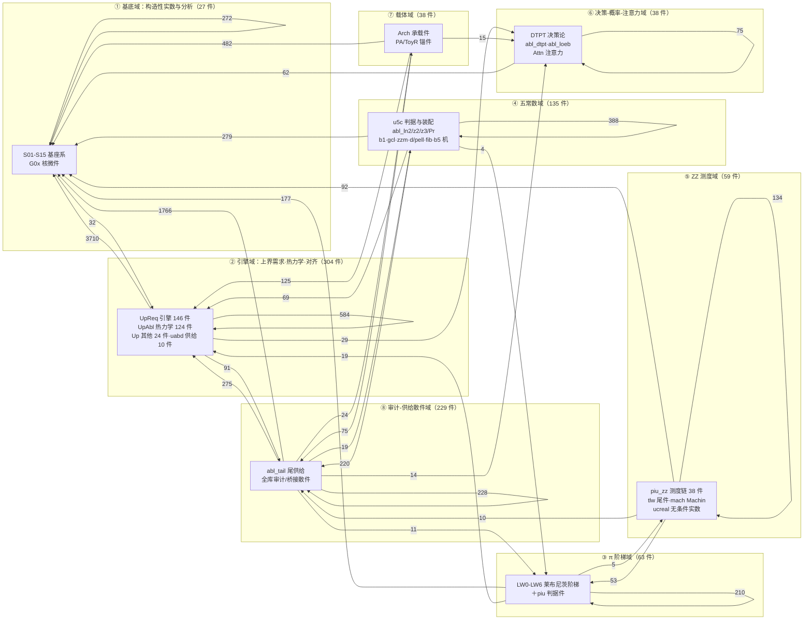
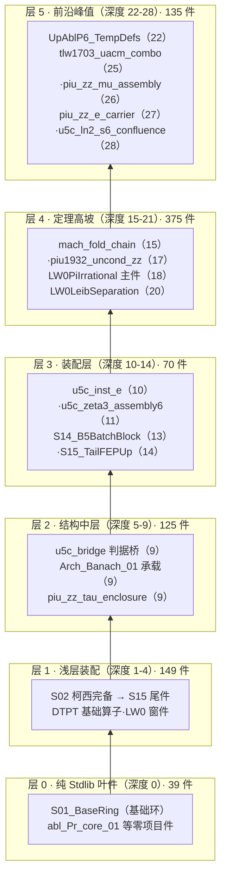
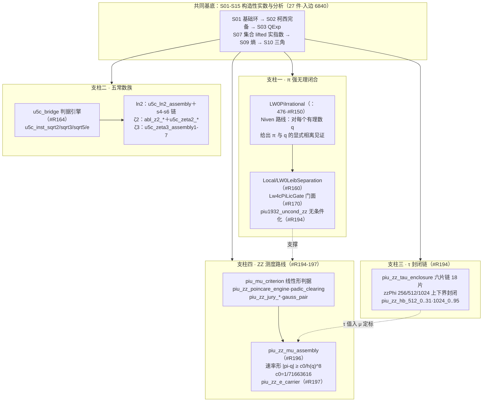
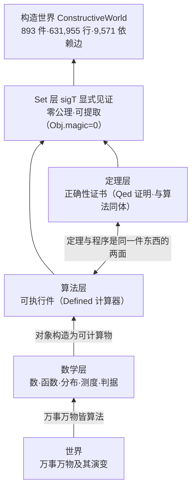

# 构造世界结构志（ARCHITECTURE）

**数据基准日：2026-10-28**（全部数字为当日对 `ConstructiveWorld_Live/` 工作树的实测值；统计口径与复算命令形见附录 A/B。本档只读实勘生成，不改动任何源件、注册面或编译产物。）

---

## 0. 哲学层：构造一切可构造的

本库的主旨可以概括为一句话：**构造一切可构造的**。它不是围绕某个定理的证明仓库，而是一项系统性的尝试——把世界的万事万物逐层构造为可计算对象。其方法论信念是：**世界的本质是算法**；算法是通用的，不专属于计算器或人工智能——万事万物的演变皆遵循算法，算法承载着世界的底层结构，涵盖一切事物的运行法则。将这一信念移植到数学基础中，得到本库的构造方式：

> 每一个 `.v` 件，都是把一段世界（一个数、一个函数、一个分布、一条测度判据）构造为类型论中可计算对象的尝试。存在不等于「假设它存在」，而是**给出见证**：全库在 Rocq/Coq 的 `Set` 层以 `sigT` 显式见证陈述存在型结论，不引入任何公理（`coqchk -o` 口径 `Axioms: <none>`）。

库 README 对此有一句精确的表述：「**定理与程序是同一件东西的两面**」——可执行件（`Defined` 计算器）与其正确性证书（`Qed` 证明）同体共存，库内称为「率即算法」范式。这正是「万物皆算法」命题在类型论中的实现形态：当一个数学对象被构造性地给出时，关于它的定理同时就是产生它的程序。全库可经 `Separate Extraction` 提取为目标语言代码并以 `Obj.magic` 计数为零作机械检查，即：**命题层没有内容泄入算法层**——构造的纯粹性是可机械审计的。

由此，本库自有理数基底出发，逐层构造出实数、分析、概率、信息论、决策与强化学习对齐、三角函数与 π、无理性判据与无理测度——一座「从算术到世界」的构造塔（图 ⑤）。

---

## 1. 全库总览（2026-10-28 实测）

| 指标 | 值 | 口径 |
|---|---|---|
| 源件 `.v` 总数 | **893** | 根 892 ＋ `Local/` 1 |
| 源件总行数 | **631,955** | 根 626,232 ＋ `Local/` 5,723 |
| 在册件（注册序） | **844** | `order.txt` 844 行，行序即编译依赖序 |
| 注册批次号跨度 | `#R0` → `#R197`（74 个批次号，**不连续**） | 批次号为累积编号，非顺序号 |
| 在册外源件 | **49**（含探针件 `_twc_probe.v`） | 树内有 `.v` 而未列入 `order.txt` |
| `Require` 词元总量 | 17,612 | 全部 `.v` 件 `Require`/`From … Require` 行的模块词元 |
| 内部依赖词元（指向库内件） | 11,403 | 词元能匹配树内 `.v` 件名 |
| Stdlib 依赖词元 | 6,209 | 指向 `QArith`/`Arith`/`Lia`/`List` 等 |
| 去重后内部文件级依赖边 | **9,571** | 有向边「件 → 其 Require 的库内件」，去重 |
| 提取产物 | 根目录 `.ml`/`.mli` 各 177 | `Separate Extraction` 面的落盘审计对象 |
| 直接依赖基底两件之一 | 734 / 893 件 | `Require S01_BaseRing` 或 `S02_CauchyComplete` |

**双树布局**：`ConstructiveWorld_Live/`（源码树，含 `order.txt` 与 `_CoqProject`，`-Q . ""` 扁平命名空间）与 `ConstructiveWorld_vo/`（产物树，另含 `.vo`/`.glob` 等）。根级另有 `CLA/`（贡献者许可）、`docs/`（本档所在）、`releases/`（220 版历史单文件合并版）、`scripts/`（注册序维护与 CI 哨兵）、`attn/`（历史工作记录）、`Makefile`/`build.sh`（构建入口）。

---

## 2. 图集

### 图 ① 全域地图（domain map）

节点＝模块族聚合而成的**八个数学域**；边＝域间实测依赖边（去重文件级，标注边数，仅绘 ≥50 的 31 条主流量）。读法：**基底域是被依赖的绝对汇点**（入边 6,840，占全库 71.5%）；引擎域是最大的依赖发出方（出边 4,414）。



图例：节点括注为域内主要件族与件数；边标为去重文件级依赖边数（2026-10-28 实测，口径见附录 A.3）。另有 18 条 <10 的低流量边未绘（PI→ZZ、FIVE→PI 等已绘；S_base→MISC 2、S_base→DECISION 1、PI→DECISION 1、DECISION→ENGINE 1、DECISION→CARRIER 1、CARRIER→CARRIER 1 六条合计 7 边的回边与端流从略，全表见 §5.2）。

### 图 ② 依赖分层拓扑（layered topology）

分层依据＝**require 链深度**：`depth(f)=0` 若 f 不 Require 任何库内件，否则 `depth(f)=1+max(depth(被依赖件))`（最长链；复算命令见附录 A.4）。全库最大深度 **28**（`u5c_ln2_s6_confluence.v`）。



图例：节点标注为该层代表性件名（逐字转录）＋实测深度。分布：深度 0 有 39 件；1-4 层 149 件；5-9 层 125 件；10-14 层 70 件；15-21 层 375 件；22-28 层 135 件。反向统计：**423 件不被任何库内件 Require**（树的消费顶端）。

### 图 ③ 注册演进时间线（growth timeline）

注册序 `order.txt` 的批次号序列（#R0 至 #R197，74 个批次号·844 件）按主题聚类为十波。批次号不连续（#R1-R100 等空缺），为累积编号。

```mermaid
graph LR
  E0["#R0 基线导入<br/>359 件<br/>S01-S15 基座·G 核·DTPT<br/>Attn·UpAbl/UpReq 初批·Arch·PA"]
  E1["#R101-132 引擎与热力学<br/>58 件<br/>UpAblP6 温度化·UpReq 判据<br/>Arch·PA 锚扩容"]
  E2["#R133-139 审计波与<br/>π 阶梯诞生<br/>59 件<br/>abl 审计 45 件·#R137<br/>LW0-LW6 阶梯 20 件"]
  E3["#R141-152 主件落装<br/>32 件<br/>LW 尾段·#R150<br/>LW0PiIrrational：476"]
  E4["#R153-160 大审计波<br/>123 件<br/>#R157 单波 61 件·ln2·loeb<br/>#R160 Local 分离件"]
  E5["#R161-171 五常数诞生<br/>39 件<br/>#R164 u5c 桥·√2√3e<br/>#R167 ζ2·#R171 √5"]
  E6["#R172-179 尾部门与<br/>Machin<br/>21 件<br/>tlw 门·mach 恒等式<br/>ucreal 无条件"]
  E7["#R181-189 五常数扩张<br/>94 件<br/>ζ3 装配 1-5·ln2 s4-s6<br/>d/pell 数族"]
  E8["#R190-193 高斯机器<br/>18 件<br/>gcl·zzm·zb3·fib·d41"]
  E9["#R194-197 ZZ 测度路线<br/>41 件<br/>#R194 38 件 τ 封闭链<br/>#R196 μ 装配·#R197 e 载体"]
  E0 --> E1 --> E2 --> E3 --> E4 --> E5 --> E6 --> E7 --> E8 --> E9
```



图例：节点上行为批次段与主题、中行为件数（实测和＝844）；下行为该波代表面。成长形态为「**基线一次性导入 → 主件落装 → 审计/装配双浪交替 → 前沿收窄**」：#R0 基线占全库 42.5%，此后单波峰值 #R157（61 件）与 #R194（38 件）分别对应审计装配浪与 τ 封闭链工程。

### 图 ④ 四支柱（认证态构造成果）

依据库 README §1-2 现势与树内实测件名绘制。四支柱均立在共同基底（① 基底域）之上。



图例：实线＝实测 Require 谱系方向；虚线＝成果间的支撑关系（依据 README §1-2 与件头注记）。认证态：库版本 `8df6c9f`（2026-10-26），本地双线 `coqchk` ALL_PASS 且 `Axioms: <none>`，CI 认证在途（README §2 原文）；π 主件位于注册序 ：476（实测核对一致）。

### 图 ⑤ 构造塔（哲学叙事总览）

「万物皆算法」命题的类型论实现路径：世界被逐层翻译为算法，算法被逐层构造为 `Set` 层的可计算对象。



图例：自下而上为构造方向；塔身即本库，塔基是有理数基底（S01-S03），塔尖是当前的 ZZ 测度路线前沿（#R197）。

---

## 3. 领域志

以下八节对应图 ① 的八域。件数/行数为 2026-10-28 实测；代表件名为树内逐字转录；使命段摘译自各件文件头「使命/Mission」注记。

### 3.1 基底域——构造性实数与分析（27 件·134,677 行）

库的地基与公共依赖汇点：入边 6,840（占全库 71.5%）。`S01_BaseRing.v` 奠定实数接口、三类索引（接口字段/Section Variables/已证定理）与基础代数序引理，明确「R 层自定义 Id 等价用显式 id_trans/id_cong 链、禁临时公理面」的纪律；`S02_CauchyComplete.v` 给出柯西完备实数核；`S03_QExp.v` 供有理数幂与阶乘；`S07_RealSetoidExpLog.v` 承载实层指数对数；`S09_EntropyReal.v` 构造熵与 Boltzmann 分布的实层（KL 分解、Gibbs 等式）；`S10_KVQuantTrig.v` 供三角函数面（`cauchy_real_sin`/`real_pi_geom`）。`G0x_core_micro` 十二件为核微件（如 `G01_CoreMicro.v` 的自由能极小唯一性与双副本枚举反例）。

代表件：`S01_BaseRing.v`、`S02_CauchyComplete.v`、`S03_QExp.v`、`S09_EntropyReal.v`、`S10_KVQuantTrig.v`、`S14_B5BatchBlock.v`（13,000+ 行批块）、`G01_CoreMicro.v`。认证态：全在册（#R0 基线，S11/S12/S14 于 #R153 重注册）。

### 3.2 引擎域——上界需求·热力学·对齐（304 件·195,838 行）

全库最大的域，也是最大的依赖发出方（出边 4,414，其中 3,710 条直落基底域）。`UpReq_*`（146 件·123,886 行）是「上升需求」引擎：Pade 逼近尾项、交错和引擎、Banach 范数与二项式面、无理性判据（`UpReqIrrationalCriterion.v` 的 `lic_irrational_criterion` 为五常数族的母判据）、熵单调、温度对偶等。`UpAbl_*`（124 件·47,001 行）为热力学化装配件：`UpAblP6_TempDefs.v` 在单点求和载体上温度化 Boltzmann（配分函数/温度化分布/能量期望/熵显式式全 Set 层形式化），延伸至热第二定律、注意力与 GRPO/DPO 对齐面的实例。`Up_other` 24 件与 `uabd_supply` 10 件为该域的供给与消解件。

代表件：`UpReqPadeTailPos.v`、`UpReqIrrationalCriterion.v`、`UpAblP6_TempDefs.v`、`UpAblMetaEngine.v`、`uabl_attn_full_instance.v`。认证态：主体在册（该域另有 39 件在册外差集件，见 §6）。

### 3.3 π 阶梯域（63 件·40,423 行）

第一支柱的主干。`LW0-LW6`（LW＝Leibniz 窗路线）自 `LW0LeibWindow.v`（#R137 起 38 件）逐级架设：微分代数、载子、交错和、计数界，直至主件 `LW0PiIrrational.v`（#R150·注册序 ：476·18 层深）——「对每个有理数 q，给出圆周率与 q 的显式相离见证」，技术路线为 Niven 型积分论证的代数化（件头注明对标 I. Niven, Bull. Amer. Math. Soc. 53 (1947)，并注明「Coq 标准库无对应物」）。`Local/LW0LeibSeparation.v`（#R160·20 层深·5,723 行）给出强分离面；`Lw4cPiLicGate`/`Lw4cPiLicFaceNonempty`（#R170）为门面件；`piu_leibsep` 17 件（#R181-193）与 `piu1932_uncond_zz`（#R194）继续向无条件化与更紧窗推进。

代表件：`LW0PiIrrational.v`、`LW0LeibWindow.v`、`Local/LW0LeibSeparation.v`、`Lw4cPiLicGate.v`、`piu1932_uncond_zz.v`。认证态：主件在册·本地 coqchk 全绿（README §2）。

### 3.4 五常数域（135 件·59,961 行）

第二支柱：√2、√3、√5、e、ln 2 的构造性无理性分离件族与 ζ(2)、ζ(3) 方向。`u5c_bridge.v`（#R164）把母判据 `lic_irrational_criterion` 的逃逸点提升为显式参数（件头：尾控/逃逸窗/窗宽消失三职一肩），`u5c_inst_sqrt2/sqrt3/sqrt5/e`（#R164/#R171）逐一实例化；ln 2 方向有 `u5c_ln2_assembly` 及 s4-s6 六段链（#R185/#R188，其中 `u5c_ln2_s6_confluence.v` 为**全库最深件**，深度 28）与 `abl_ln2_*` 22 件；ζ(2) 走 Beukers 法机械件（`abl_z2_*` 7 件·#R167：整除/衰减/计数＋`u5c_zeta2_*` 装配）；ζ(3) 有 `u5c_zeta3_assembly` 1-7 号装配链（#R186-193）。辅助机械面：素数域 `abl_Pr_*`（试除判性/最小素因子/因子分解存在形）、`b1_*` Beukers 核、`gcl_*` 高斯系数链、`zzm1_gauss`/`zb3*`、`d3/d6/d13/d14/d41/d7/pell` 数族、`fib_machine`、`b5_machine`。

代表件：`u5c_bridge.v`、`u5c_inst_e.v`、`u5c_ln2_s6_confluence.v`、`u5c_zeta3_assembly6.v`、`abl_z2_itg_carrier.v`、`abl_Pr_core_01.v`。认证态：√2/√3/e/ln2 分离件批量在册（README §1：#R164 起）；ζ(2) 闭式定理装配进行中（README 原文登记）。

### 3.5 ZZ 测度域（59 件·40,587 行）

第三、四支柱所在的前沿域。#R194 波 38 件完成 τ 封闭链：原 24,636 行单体巨件 `piu_zz_tau_enclosure.v` 经机械拆分落装为六片链 18 片（head/bank1-4/base/literals/phi1024_slim/hb_wave1-8），128 个匿名 assert 块升格为独立引理 `piu_zz_hb_512_0..31`／`piu_zz_hb_1024_0..95`，zzPhi 256/512/1024 字面值链上下界封闭（`piu_zz_tau_enclosure_head.v` 头注：语句面逐字节等价、零假设零公理）。测度路线：`piu_mu_criterion.v` 给出线性形无理测度判据（μ(x) ≤ 1+σ/τ 的 q^(−μ) 逼近下界形），`piu_zz_poincare_engine`/`piu_zz_padic_clearing`/`piu_zz_jury_*` 提供引擎面，`piu_zz_mu_assembly`（#R196）装配速率形证书 **|π−q| ≥ c0/h(q)^8（c0=1/71663616，h(q)=1+q 的分母）**，`piu_zz_e_carrier`（#R197·树内最新件）承载 E 侧载体与条件 μ 证书链。域内另含 `tlw_*` 13 件（尾部门与 Padé 面）、`mach_*` 3 件（J. Machin 1706 恒等式级数折叠）、`ucreal_*`/`uacm` 5 件（无条件分离面）。

代表件：`piu_zz_tau_enclosure.v`、`piu_zz_tau_enclosure_head.v`、`piu_mu_criterion.v`、`piu_zz_mu_assembly.v`、`piu_zz_e_carrier.v`、`mach_fold_chain.v`、`tlw1703_uacm_combo_unconditional.v`。认证态：#R194 波在册·本地 coqchk 4 组并行 ALL_PASS（README §5）。

### 3.6 决策-概率-注意力域（38 件·28,844 行）

把概率与决策构造为 Set 层对象的域。`DTPT_*` 10 件（14,919 行）：`DTPT.v` 承载 insert_q/P0/rot/interleave 基础算子、去重族、置换不变、熵面、频数测度层与频数—熵代数；`DTPT_Bridge_Dep.v` 为恒等簇处置的 Set 形证书层（八簇抽验＋八件闭式数值锚＋逐件 Extract）。`Attn_*` 4 件：`AttnDoeblin.v` 以双点全变差收缩构造注意力链的 Doeblin 界。`abl_dtpt_*` 18 件为决策论桥接供给（dig/truth/yellow/rot 桥），`abl_loeb_*` 6 件为 Loeb 型构造。

代表件：`DTPT.v`、`DTPT_Bridge_Dep.v`、`AttnDoeblin.v`、`abl_loeb_d3.v`。认证态：主体在册（#R0 基线＋#R153/#R154 补充）。

### 3.7 载体域（38 件·31,551 行）

命题族集注与实例化承载面。`Arch_*` 18 件（如 `Arch_Banach_01.v`：bnhn/bxcb 命题族集注与实例化承载，头注注明「全件 Qed 闭合、零承认词面、语句面以 Set 层承载零 Prop 泄露」）；`PA_*`/`ToyR_*` 20 件为论文锚件与 ToyR 切片（`ToyR_fa56b_ext.v` 等），其中多件系「同名替换稿」——语句面零动、仅换核验微刀的重建件（`S01_BaseRing.v` 头注所载工作形态的载体化）。

代表件：`Arch_Banach_01.v`、`Arch_PA_01.v`、`PA_DTPT_Bridge_Dep.v`、`ToyR_EntropyMonoSplitInst.v`。认证态：分批在册（#R113/#R116/#R161）。

### 3.8 审计-供给散件域（229 件·100,074 行）

库的工程化免疫系统。`abl_tail_*`/`abl9*`/`ablt9*`/`abl_tbase_*` 40 件为「尾百假设消解」供给件：对库尾模块的接口假设批量供给非平凡证明（如 `abl_tail_supply_65..70`、`abl_tbase_zapfeed`）。其余 189 件散件覆盖：热力学-KL 簇（`RealKLDecomp.v`、`PinskerTwoPoint.v`、`SecondLawQuantified.v`、`FreeEnergyKLGap.v` 等约 31 件）、π 支撑簇（`BeukersIdentity.v`、`Ln2Escape.v`、`PiEnvelope.v`、`PadeErrorIntegral.v` 等约 15 件）、实数工具簇（`AbsLeId.v`、`DenPosGeneral.v` 等约 36 件）及其余单件。族簇边界按文件名关键词划分，属近似口径（附录 A.5）。

代表件：`abl_tail_supply_70.v`、`abl_tbase_zapfeed.v`、`RealKLDecomp.v`、`SumInvFactEscape.v`（闭合 Σ1/k! 逃逸目标）。认证态：#R133-157 审计双浪主体在册。

---

## 4. 族谱统计表（31 族·2026-10-28 实测）

族＝文件名前缀语义族；行数为 `.v` 源件行数。按行数降序。

| 族 | 使命归纳 | 件数 | 行数 |
|---|---|---:|---:|
| UpReq_engine | 上界需求引擎（Pade 尾项/判据/熵/对偶） | 146 | 123,886 |
| S01-S15_base | 构造性实数与分析基座 | 15 | 114,626 |
| ZZ_misc_single | 全库审计/桥接/工具散件 | 189 | 82,850 |
| UpAbl_thermo | 温度化热力学与对齐装配件 | 124 | 47,001 |
| piu_zz_measure | τ 封闭链与无理测度链 | 38 | 34,075 |
| LW_pi_ladder | Leibniz 窗 π 阶梯（含 Local 分离件 5,723 行） | 46 | 34,410 |
| Arch_carrier | 命题族集注与实例化承载 | 18 | 24,910 |
| u5c_five_const | 五常数判据引擎与实例装配 | 53 | 24,133 |
| Up_other | 上域其余装配件 | 24 | 23,821 |
| G_core_micro | 核微件（自由能/熵律/反例） | 12 | 20,051 |
| abl_tail_tbase | 尾部假设消解供给件 | 40 | 17,224 |
| DTPT_decision | 决策论基础算子与证书层 | 10 | 14,919 |
| abl_ln2_lnT | ln2 汇编与机器桥 | 22 | 11,290 |
| abl_dtpt | 决策论桥接供给 | 18 | 8,295 |
| PA_ToyR_anchor | 论文锚件与 ToyR 切片 | 20 | 6,641 |
| abl_Pr_primes | 素数域成域件单 | 14 | 6,357 |
| piu_leibsep | π 分离判据推进件 | 17 | 6,013 |
| abl_z2_zeta2 | ζ(2) Beukers 机械件 | 7 | 3,997 |
| gcl_gauss | 高斯系数链 | 7 | 3,767 |
| tlw_tail | 尾部门与 Padé 面 | 13 | 3,173 |
| abl_loeb | Loeb 型构造件 | 6 | 2,818 |
| Attn_attention | 注意力 Doeblin/平方根界 | 4 | 2,812 |
| d_pell_families | d3/d6/d7/d13/d14/d41/pell 数族 | 7 | 2,694 |
| zz_gauss_machine | 高斯线性形机（zzm/zb3/zz） | 9 | 2,311 |
| mach_machin | Machin 恒等式级数机 | 3 | 2,210 |
| abl_z3_zeta3 | ζ(3) 衰减/计数机械件 | 5 | 1,940 |
| b1_beukers | Beukers 核机器（b1_*） | 7 | 1,512 |
| uabd_supply | 上域假设消解供给 | 10 | 1,130 |
| ucreal_uncond | 无条件构造实数分离面 | 5 | 1,129 |
| b5_machine | b5 计数机 | 1 | 1,056 |
| fib_machine | Fibonacci 机械件 | 3 | 904 |
| **合计** | | **893** | **631,955** |

---

## 5. 依赖边统计（2026-10-28 实测）

### 5.1 域级出入度

| 域 | 件数 | 行数 | 入边 | 出边 |
|---|---:|---:|---:|---:|
| 基底（S01-S15＋G0x） | 27 | 134,677 | **6,840** | 307 |
| 引擎（UpReq/UpAbl/Up 其他/uabd） | 304 | 195,838 | 1,105 | **4,414** |
| 五常数（u5c＋abl_z2/z3/ln2/Pr＋b1/gcl/zz/d/pell/fib/b5） | 135 | 59,961 | 407 | 960 |
| π 阶梯（LW/piu） | 63 | 40,423 | 278 | 427 |
| ZZ 测度（piu_zz/tlw/mach/ucreal） | 59 | 40,587 | 139 | 289 |
| 决策-概率-注意力（DTPT/abl_dtpt/abl_loeb/Attn） | 38 | 28,844 | 135 | 139 |
| 载体（Arch/PA/ToyR） | 38 | 31,551 | 26 | 698 |
| 审计-供给散件（abl_tail＋misc） | 229 | 100,074 | 641 | 2,337 |
| **合计** | **893** | **631,955** | **9,571** | **9,571** |

### 5.2 域间边全表（38 对·按流量降序）

| 发出域 → 承接域 | 边数 | | 发出域 → 承接域 | 边数 |
|---|---:|---|---|---:|
| 引擎→基底 | 3,710 | | 决策→基底 | 62 |
| 散件→基底 | 1,766 | | ZZ→π 阶梯 | 53 |
| 引擎→引擎 | 584 | | 基底→引擎 | 32 |
| 载体→基底 | 482 | | 引擎→决策 | 29 |
| 五常数→五常数 | 388 | | 散件→载体 | 24 |
| 五常数→基底 | 279 | | π 阶梯→引擎 | 19 |
| 散件→引擎 | 275 | | 散件→五常数 | 19 |
| 基底→基底 | 272 | | 载体→决策 | 15 |
| 散件→散件 | 228 | | 散件→决策 | 14 |
| 五常数→散件 | 220 | | 散件→π 阶梯 | 11 |
| π 阶梯→π 阶梯 | 210 | | ZZ→散件 | 10 |
| π 阶梯→基底 | 177 | | π 阶梯→ZZ | 5 |
| ZZ→ZZ | 134 | | 五常数→π 阶梯 | 4 |
| 载体→引擎 | 125 | | 基底→散件 | 2 |
| ZZ→基底 | 92 | | 基底→决策 | 1 |
| 引擎→散件 | 91 | | π 阶梯→决策 | 1 |
| 决策→决策 | 75 | | 决策→引擎 | 1 |
| 载体→散件 | 75 | | 决策→载体 | 1 |
| 五常数→引擎 | 69 | | 载体→载体 | 1 |

### 5.3 结构要点

- **星形依附**：9,571 条边中 6,840 条（71.5%）指向基底域；734/893 件直接 Require `S01_BaseRing` 或 `S02_CauchyComplete`。库的「编译序＝order.txt 行序」由此保证。
- **自 cohesive 的 π 链**：π 阶梯域内部边 210 条，为诸域中内聚最强（LW 系列件间的链式 Require），域外仅主要下探基底（177）。
- **五常数的机械件伴生结构**：五常数域内边 388 条之外，向 abl 散件域发边 220 条——Beukers 机械件（abl_z2/z3/ln2/Pr）与 u5c 装配面之间的伴生消费关系。
- **长尾而非浅层**：require 深度分布（39/149/125/70/375/135 于 0/1-4/5-9/10-14/15-21/22-28 层）显示库主体位于 15-21 层深坡；最深链 28 层止于 `u5c_ln2_s6_confluence.v`。

---

## 6. fail-loud 登记（数据对不上处·不强行归一）

以下歧义与漂移在实测中发现，逐条如实登记：

1. **README 注册数滞后**：README §1/§2 称 `order.txt` 841 行，实测 **844 行**。差额 3 件为 `piu1930_domface_negative.v`（#R195）、`piu_zz_mu_assembly.v`（#R196）、`piu_zz_e_carrier.v`（#R197）——README 撰写后新增，README 未随之更新。
2. **在册外差集件数漂移**：README §8 称 45 件（另 1 件探针 `_twc_probe.v`），实测树内未在册 `.v` 共 **49 件**（含探针）。README 登记口径「随公开前置批次裁定」，本档以 2026-10-28 实测为准。
3. **任务书件名无对应**：摸底任务书所称「`piu_zz_ec_mu_cond` 六前提链」在树与注册序中**均无此件名**。实测 μ 证书链的实际件名为 `piu_mu_criterion.v`（判据）→ `piu_zz_mu_assembly.v`（速率形装配）→ `piu_zz_e_carrier.v`（E 侧载体与条件 μ 证书链·件头自述「from the explicit premise group to the rate-form real-layer certificate」）。本档按实勘件名记载，任务书名称疑为该链的内部代称。
4. **双树漂移**：`ConstructiveWorld_vo/` 根比 `ConstructiveWorld_Live/` 根多 5 个 `.v`：`LW3Z2SqSqueeze.v`、`_b1328_probe_bridge.v`、`_probe1460a.v`、`_probe1460f.v`、`_probe1460q.v`。CI 有 gate3 跨树 diff 哨兵把守（README §2），本档如实登记当日差集。
5. **Local 边口径**：`Local/LW0LeibSeparation.v` 被其他件以裸名 Require 时，本统计的文件面匹配（按根名）无法命中 `Local/` 路径键，该 1 件的被依赖边归入 Stdlib 桶；对总量影响不超过 1 条边，方向为低估。
6. **散件簇口径**：§3.8 的散件三簇（热力学-KL/π 支撑/实数工具）为文件名关键词匹配的近似分类，非精确语义分类；族级（§4）统计为精确前缀匹配。
7. **Stdlib 词元噪声**：Require 行内尾随注释（如 `(* ...`）会产生少量伪词元，均已因无法匹配文件面而落入 Stdlib 桶，不影响内部边集。

---

## 附录 A · 统计口径与复算命令形

全部命令在 `ConstructiveWorld_Live/` 内执行（Git Bash；2026-10-28 实测通过）。

**A.1 件数与行数**：
```sh
ls *.v Local/*.v | wc -l                 # 893
wc -l *.v Local/*.v | tail -1            # 631955
sed 's/#.*//' order.txt | sort > /tmp/reg.txt
ls *.v | sort > /tmp/tree.txt
comm -13 /tmp/reg.txt /tmp/tree.txt | wc -l   # 在册外 49
```

**A.2 批次波次**：
```sh
awk -F'#R' '{split($2,a,"-"); print a[1]}' order.txt | sort -n | uniq -c | sort -k2 -n
```

**A.3 依赖边**：对每件 `.v` 抽取 `Require`/`From X Require` 行的模块词元；词元加 `.v` 后能命中树内件名者记为内部边，否则记 Stdlib；`(源件,目标)` 去重后得 9,571 边。域归属按 §4 族谱的前缀函数映射。

**A.4 require 深度**：`depth(f)=0`（无内部 Require）；否则对每条边「f 依赖 t」迭代松弛 `depth(f)=max(depth(f), depth(t)+1)` 至不动点（实现为 awk，迭代 80 轮封顶，实测 28 层收敛）。

**A.5 族谱与散件簇**：族按 §4 表的前缀正则（首匹配优先级即表序）；散件三簇按关键词 `KL|Entropy|Boltz|Gibbs|...`、`Pi|Sin|Arctan|Trig|Leib|...`、`Real|Cauchy|Sqrt|Q|...` 依次匹配。

## 附录 B · 数据可信度声明

- 本档所有件名、行号（如 `LW0PiIrrational.v` 位于 `order.txt` :476）均为树内逐字转录或机械输出，无脑补项；凡实测与既有文档（README）不一致处，一律登记于 §6，不改动既有文档，不强行归一。
- 本档生成过程零编译、零网络、零提交、零 push；除本档外未向仓库树写入任何文件。
